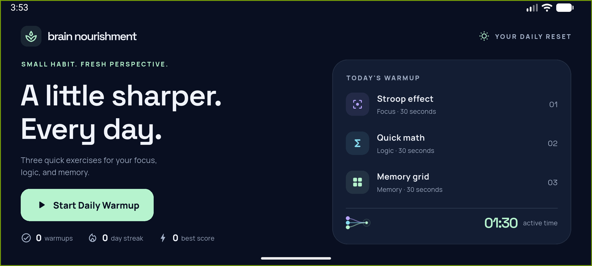

# Brain Nourishment

A focused, offline Android app for easing into your morning. A guided 90-second warmup starts gently with memory, then builds through focus and math. Six games, other session modes, and individual practice stay available in a portrait interface.



## Features

- **Morning wake-up:** the main action on the home screen. An optional Sleepy / Getting there / Ready check-in suggests a finishing difficulty that you can override. Each 30-second round builds toward that level: Standard/Standard/Standard, Standard/Standard/Challenge, or Standard/Challenge/Expert.
- **A moment to settle in:** optional prompts to sit up, let in daylight if available, and take a comfortable breath. They do not gate the games.
- **Morning reflection:** optionally record how awake you feel afterward and one intention for the day. The intention appears on the home screen and is carried into a same-day repeat so it can be kept or edited.
- **Morning habit tracking:** a rolling seven-day view, distinct morning days, and a separate morning streak. Other training modes and practice do not fill the morning tracker.
- **Stroop effect:** identify the ink color while ignoring the conflicting color word. Challenge and Expert shuffle the answer positions after each question.
- **Quick math:** choose **True or false** or **Calculate it** before the round in any session. Calculate it hides the answer so you work it out yourself, then enter it on the number pad and tap the check mark. Backspace and physical keyboard input are supported. Challenge adds multiplication; Expert uses larger numbers.
- **Memory grid:** recall three tiles on Standard (3×3, 1-second flash), four on Challenge (3×3, 0.85-second flash), or five on Expert (4×4, 0.65-second flash).
- **Number sequence:** choose the missing next number. Higher difficulties introduce growing and alternating steps.
- **Rule switch:** alternate between judging even/odd and below/above a boundary. Expert uses numbers up to 200.
- **Reaction test:** wait through a random red interval, then tap the large panel as soon as it turns green. Response time starts when the green cue is painted and stops on touch-down. Early taps count as false starts and stay out of the average. The round and results show average and best response times in milliseconds. An interrupted trial restarts after pausing. Space or Enter also works with a physical keyboard.
- **Session modes:** Daily includes focus, math, and memory for 30 seconds each. Full circuit includes all six games for 30 seconds each (180 seconds); Sprint includes all six for 15 seconds each (90 seconds).
- **Individual practice:** play any one of the six games for 30 seconds. Practice does not change completed-warmup totals, best scores, or streaks.
- **Difficulty selection:** Standard, Challenge (the default), and Expert, with instructions matching the selected rules.
- **Daily progress:** completed warmups, calendar-day streaks, and best session scores saved on-device.
- **Session controls:** instructions before each round, pause/resume, automatic pause when backgrounded, and per-game results.
- **Portrait layout:** vertically stacked game boards and controls, dark theme, bundled fonts, and scrolling for small phones or larger text settings.

Instructions, check-ins, and pauses do not consume the timer. Correct answers and valid reactions earn 10 points; memory earns 10 points per correctly recalled tile in a submitted pattern. At zero, no new question starts: finish the current question, preview, or reaction trial, or choose **End round without this question**. An unanswered question or partly entered grid is never counted as a miss. Submitted wrong answers still count as attempts. Session duration labels cover the countdown; finishing the final question can add time. Finishing every game in Morning wake-up, Daily, Full circuit, or Sprint records a warmup; exiting early does not. The best score is the highest raw completed-warmup total across these modes and difficulties.

Progress survives app restarts, including upgrades from the earlier saved-progress format. Replays count as additional warmups but extend streaks only once per local calendar day. Morning history retains the latest entry for each of the last 60 recorded days; lifetime counters and longer streaks are retained separately. Check-ins record your own impression of how awake you feel. There are no accounts, cloud sync, or network requirements. Sessions interrupted by process termination are not restored.

The routine can be used whenever you wake up; it has no fixed morning-hour cutoff. The 90-second label covers active play only. Preparation and reflection are optional and untimed. Morning light is included as a practical cue, informed by [CDC/NIOSH guidance on light and alertness](https://archive.cdc.gov/www_cdc_gov/niosh/emres/longhourstraining/light.html).

[Morning setup](docs/screenshots/morning-setup.png) · [Morning memory round](docs/screenshots/morning-memory.png) · [Morning reflection](docs/screenshots/morning-results.png) · [Focus screenshot](docs/screenshots/focus.png) · [Math screenshot](docs/screenshots/math.png) · [Memory screenshot](docs/screenshots/memory.png) · [Sequence screenshot](docs/screenshots/sequence.png) · [Rule switch screenshot](docs/screenshots/switching.png) · [Results screenshot](docs/screenshots/results.png)

## Next ideas

- Optional reminders at your chosen wake-up time.
- A rotating morning game mix that keeps the gentle start while adding variety.

These are ideas for a later version and are not implemented yet.

## Development requirements

| Tool | Version / requirement |
| --- | --- |
| Flutter | **3.47.0 stable**, matching CI |
| Dart | **3.13.0**, bundled with Flutter |
| Java | **JDK 17** in CI; the Android Studio JDK also works locally |
| Android tooling | Android Studio or Android SDK command-line tools; accept the SDK licenses |
| Python | **3.13+** for release tooling and its tests; no Python packages required |
| Device | Android phone with USB debugging, or an Android emulator |

Flutter installs the Android SDK/NDK components requested by the project when the SDK tools and licenses are available. Diagnose local setup with `flutter doctor -v`; review missing licenses with `flutter doctor --android-licenses`.

Android is the only app target. No iOS, Web, Windows, macOS, or Linux app folders are included.

## Get started on another machine

1. Install Git, the Flutter version above, Android Studio/SDK tools, a JDK, and Python. Add Flutter and Python to `PATH`.
2. Fork the repository if contributing, then clone your fork. Replace the example URL with the repository URL:

   ```sh
   git clone https://github.com/YOUR-USERNAME/brainnourishment.git
   cd brainnourishment
   flutter pub get --enforce-lockfile
   ```

3. Start an emulator in Android Studio, or connect an Android device with USB debugging enabled:

   ```sh
   flutter devices
   flutter run -d <android-device-id>
   ```

Contributors **do not need the permanent signing key**. Debug builds use the local Android development key. Flutter generates `android/local.properties` for each machine; it is intentionally ignored.

The Android manifest is part of the native application. Changes to orientation, signing, application IDs, or native resources require a full rebuild/reinstall rather than hot reload.

### Checks before opening a pull request

```sh
dart format --output=none --set-exit-if-changed lib test
flutter analyze
flutter test
python -m unittest discover -s tool/tests -v
flutter build apk --debug
```

Keep game behavior in the controller/domain layers and UI rendering in the presentation layer. Include a test when changing timing, scoring, progress, or release behavior. For visual changes, check a small portrait phone and enlarged text. Use descriptive commit messages; they become release notes. Conventional prefixes such as `feat:`, `fix:`, `perf:`, `docs:`, and `ci:` produce grouped changelog sections. Breaking changes can use `feat!: ...` or a `BREAKING CHANGE:` message body.

## Project structure

```text
lib/
  main.dart                  Flutter initialization and fixed portrait lock
  src/
    app.dart                 Navigation and app-level progress state
    application/             Warmup clock, scoring, pause, exercise transitions
    domain/                  Exercise models and calendar-day progress rules
    data/                    Injectable local progress repository
    presentation/            Home, games, results, shared widgets, theme
android/                     Android host, signing configuration, native resources
assets/fonts/                Bundled fonts and their licenses
test/                        Game, progress, layout, and navigation tests
tool/
  release.py                 CI versioning, source verification, changelog, publication
  signing.py                 Local key creation, inspection, and GitHub secret export
  tests/                     Release and signing tooling tests
.github/workflows/
  android-build.yml          Tests and packages every main push and PR update
  publish-release.yml        Publishes verified packages from successful builds
```

State uses Flutter's `setState`, `ChangeNotifier`, and `AnimatedBuilder`. Progress uses `SharedPreferencesAsync` with Android DataStore. Widgets do not own persistence or game rules.

The stable application ID is `com.brainnourishment.brain_nourishment`. Keep it and the signing identity unchanged when distributing updates. The app requests `DeviceOrientation.portraitUp` in Dart and `portrait` in the Android manifest. Check orientation behavior on intended devices and windowing configurations.

## Automated GitHub releases

| Event | Output | Signing |
| --- | --- | --- |
| Successful push to `main`, including a merged PR | Stable GitHub release, APK, and AAB | Permanent signing key |
| Any PR: opened, updated, or reopened | GitHub prerelease and APK | Disposable development key |

Release titles follow **Brain Nourishment v1.0.1**. PR preview release titles follow **Brain Nourishment v1.0.2-pr.42**; the PR itself can have any descriptive title. Preview apps use the separate `.preview` application ID and the launcher name **Brain Nourishment Preview**, so they do not replace the stable app. A preview key can change between runners, which can require uninstalling an older preview before installing the next one.

Every release contains a commit-message **Changelog** in its description, a downloadable `CHANGELOG.md`, build metadata, and `SHA256SUMS.txt`. Stable changelogs compare against the previous reachable stable tag; the first stable release includes the available commit history. Preview changelogs contain the PR's commits relative to its base.

### Versioning and overwrite prevention

CI combines the version baseline in `pubspec.yaml` with the **Android build workflow's run number**:

```text
app patch      = baseline patch + workflow run number
Android code   = baseline build + workflow run number
preview suffix = -pr.<pull-request-number>
```

With the checked-in `1.0.0+1` baseline:

| Workflow run | Example event | App version | Release tag |
| --- | --- | --- | --- |
| 1 | Push to main | `1.0.1+2` | `v1.0.1` |
| 2 | PR #42 | `1.0.2-pr.42+3` | `v1.0.2-pr.42` |
| 3 | Push to main | `1.0.3+4` | `v1.0.3` |

The run number is shared by main and PR builds, so gaps in stable patch numbers are expected. Failed runs consume a number. Each push gets its own run; newer pushes do not cancel older builds. CI updates the disposable checkout's app version without making version-bump commits or pushing source changes.

Rerunning a workflow keeps its version. If that run already published a release, publication skips it without changing any assets. An unrelated existing tag or release causes a failure rather than an overwrite. No workflow uses `--clobber`, force-pushes a tag, or edits an existing release.

Keep the build workflow filename and run history. Do not lower the version baseline. Before recreating a workflow or migrating repositories, raise the baseline patch and build number above previously distributed values. Major/minor releases can be selected by increasing the corresponding baseline in `pubspec.yaml`.

### Owner setup on GitHub

1. Create the GitHub repository with `main` as its default branch and upload the project source when ready. Both workflows must be present on `main` before the trusted publisher can run.
2. In **Settings → Environments**, create **`android-release`**. Under deployment branches/tags, choose **Selected branches and tags** and add a **branch rule matching only `main`**. A required reviewer is optional; omit it for unattended releases.
3. Add the four signing values below as **environment secrets inside `android-release`**. Do not store the permanent signing identity as repository-wide secrets. The branch restriction prevents unreviewed PR workflows from requesting it.
4. The `android-preview` environment contains no signing secrets. It can be created empty in advance or by the first preview run.
5. Enable GitHub Actions and allow the workflows' declared token permissions under repository/organization policy. The build token is read-only. The publisher needs `contents: write`, `actions: read`, and `pull-requests: read`; it uses the built-in `GITHUB_TOKEN`, without a personal access token.
6. Push to `main`, or open a PR, and inspect the **Android build** and **Publish Android release** runs. GitHub may require maintainer approval for a first-time fork contributor's build. Repository plans/policies must support the configured environments.

The publisher runs trusted tooling from `main`, verifies the originating workflow/run/commit and artifact metadata, and never executes PR artifact contents. PR workflows do not receive the permanent signing key. This follows GitHub's separation between [unprivileged builds and privileged `workflow_run` publication](https://docs.github.com/en/actions/reference/workflows-and-actions/events-that-trigger-workflows#workflow_run).

## Signing identity and backups

Signing files stay locally in the **project root** and are ignored by Git:

| File | Purpose |
| --- | --- |
| `brain-nourishment-release.jks` | Permanent RSA-4096 Android signing key |
| `key.properties` | Keystore path, alias, and passwords used by Gradle |
| `signing-key-info.txt` | Certificate details and public SHA-256 fingerprint |
| `signing-secrets.json` | Optional export of the four GitHub environment secret values |

Back up **the keystore and `key.properties` together** to an encrypted off-machine location before distributing a signed build. Keep a second independent backup or retain the passwords in a password manager. Base64 in the JSON export is an encoding, not encryption; the JSON and properties file contain credentials. The key is valid until 2054. The alias is `brain-nourishment`.

For APKs distributed through GitHub, future updates must use this same key. Generating a new key does not replace the old signing identity. If using Google Play App Signing later, follow its separate app-signing/upload-key process. See [Android signing documentation](https://developer.android.com/studio/publish/app-signing).

### Restore on another machine

1. Clone the source and install the development tools.
2. Retrieve your encrypted backup, then put `brain-nourishment-release.jks` and `key.properties` beside `pubspec.yaml`. Keep the original filenames; the relative path in the properties file works across operating systems.
3. Validate the restored identity and compare its SHA-256 fingerprint with your backup:

   ```sh
   python tool/signing.py info
   ```

4. Build locally with the restored signing key:

   ```sh
   flutter build apk --release
   flutter build appbundle --release
   ```

Use CI for automatically increasing public release versions. A local release build uses the checked-in baseline unless you explicitly pass both `--build-name` and `--build-number`.

Normal contributors should use debug or preview builds instead of receiving this key. If a development-signed stable app is already installed locally, Android cannot update it with the new permanent signature; use the separate preview app or deliberately remove that development installation before installing the signed stable build.

### Export GitHub signing secrets

On the machine holding the restored signing files:

```sh
python tool/signing.py export
```

Open the ignored `signing-secrets.json` locally and copy each complete value into the correspondingly named **`android-release` environment secret**:

| Secret | Content |
| --- | --- |
| `ANDROID_KEYSTORE_BASE64` | Base64-encoded keystore |
| `ANDROID_STORE_PASSWORD` | Keystore password |
| `ANDROID_KEY_ALIAS` | `brain-nourishment` |
| `ANDROID_KEY_PASSWORD` | Private-key password |

The helper does not print credential values. Once the secrets are configured, remove the local JSON export if no longer needed; retain the encrypted signing backup.

For an entirely new fork that will use its **own application ID and signing identity**, `python tool/signing.py generate` creates fresh files and refuses to overwrite existing signing material. Do not run it to restore the original app's key. `key.properties.example` documents the expected property names without credentials.

### Build a preview locally

Windows PowerShell:

```powershell
$env:BRAIN_PREVIEW_BUILD = 'true'
try { flutter build apk --release } finally { Remove-Item Env:BRAIN_PREVIEW_BUILD }
```

macOS/Linux:

```sh
BRAIN_PREVIEW_BUILD=true flutter build apk --release
```

Preview builds explicitly use a development key and `.preview` app ID. Stable release builds fail when the permanent signing configuration is missing; they do not silently fall back to a debug key.

## Repository hygiene

The repository ignores signing files, credentials, SDK paths, build output, editor files, generated APK/AAB files, and local Markdown notes. The requested Markdown rules are `*.md` and `!README.md`; release changelogs are generated assets rather than committed Markdown files. Keep `pubspec.lock`, the Android Gradle wrapper, source, tests, font licenses, and screenshots in version control.

For an existing multiplatform project, `tool/remove_unused_platforms.ps1` removes only the non-Android app folders after checking their paths. Recreating this app from an empty directory uses:

```sh
flutter create --platforms=android --org com.brainnourishment --project-name brain_nourishment --android-language kotlin .
```

## Verification and credits

The app includes Flutter tests covering all session modes and difficulties, calculation input and scoring, reaction timing and false starts, finishing or skipping questions after zero, the gradual morning routine, individual practice, old-progress migration, check-ins, long streaks, generated questions, memory phases, portrait layout sizes, enlarged text, save retries, and navigation. The final-question regression test reproduces a prompt shown with only 0.4 seconds remaining and verifies that finishing it can produce 13/13. Release tooling has 17 separate Python tests for increasing versions, overwrite refusal, artifact validation, trust boundaries, changelog generation, and signing export. Physical-device and tablet testing remain useful contributions.

The bundled **Space Grotesk** and **Manrope** fonts are distributed under the SIL Open Font License. Their license files are included in `assets/fonts/`.
